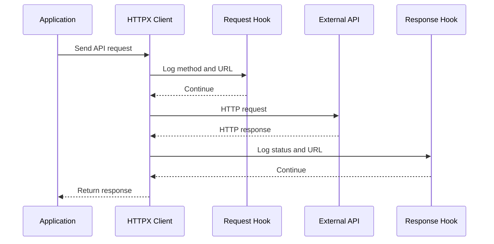

# Event Hooks

## 1. Goal

Demonstrate how HTTPX Event Hooks can be used to log outgoing requests and incoming responses for debugging, using the asynchronous API.

**References**
- [Event Hooks](https://www.python-httpx.org/advanced/event-hooks/)
- [Async Support](https://www.python-httpx.org/async/)

## 2. Application Scenario

An application calls an external API and needs basic HTTP logs to help developers troubleshoot requests and inspect responses.

Event Hooks provide a centralized way to capture request and response metadata without adding logging code to every API call.

## 3. Execution Flow

## 4. Hook Responsibilities

| Hook | Behavior |
|---|---|
| `request` | Log the HTTP method and URL before sending the request. |
| `response` | Log the response status code and URL after receiving the response. |

## 5. Implementation

- Use `httpx.AsyncClient`.
- Register both hooks through `event_hooks`.
- Use Python's standard `logging` module.
- Keep the example focused on request/response metadata.
- Avoid logging credentials, authorization headers, or sensitive data.

## 6. Testing

- Verify that both hooks execute in the expected order.
- Verify the logged request and response metadata.
- Use a mocked transport to avoid external network dependencies.

## 7. Scope

- **Included:** API logging, Event Hooks, and focused tests.
- **Excluded:** retries, authentication, distributed tracing, and complex logging infrastructure.
